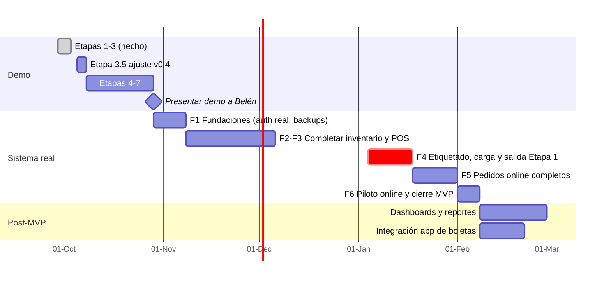

# 05 – Plan de trabajo (v0.4 – 1 tienda + bodega)

Supuesto de capacidad: **1 desarrollador ~20 h/semana con desarrollo asistido** (más el apoyo del Equipo 10).

## 1. Qué cambió respecto a v0.3 (reunión del 2026-10-02)

- **Una sola tienda (Rancagua)** + bodega (casa de Belén). Se elimina Providencia: un solo POS y una sola caja (compartida).
- **Belén opera la bodega** con su rol Admin; el rol Bodega queda para el futuro.
- **Los pedidos online se apartan al pagar**: no hay reservas por vencer (más simple).
- **Solo Belén da descuentos**: las aprobaciones remotas pasan a ser centrales en el POS.
- **Se etiqueta toda la ropa** (solo los jeans traen código): la impresora de etiquetas y el etiquetado inicial son críticos.
- **Boletas**: ya las emiten con una app (probablemente Vessi). En el MVP el POS registra el N° de boleta; baja el riesgo tributario.
- Esfuerzo: **−1 a 2 semanas** respecto a v0.3.

## 2. Estado actual (noviembre de 2026, rama `feature/demo`)

La demo está completa y publicada (Render + Neon), con **551 pruebas automáticas** aprobadas. Lo único que queda del alcance de la demo son los **cambios y devoluciones**, que esperan las respuestas de Belén (sección 8).

| Etapa de la demo | Estado |
|------------------|--------|
| 1. Base, login de demo, datos de ejemplo | ✅ |
| 2. InventoryService (concurrencia), stock y kardex | ✅ |
| 3. Identidad visual y POS (caja, ticket, ventas del día) | ✅ |
| 3.5 Ajuste a v0.4 (sin Providencia, descuento 0 %, reserva al pagar) | ✅ |
| 4. Traslados tienda ↔ bodega | ✅ |
| 5. Pedidos online desde bodega | ✅ |
| 6. Aprobaciones remotas de Belén | ✅ |
| 6.5 Reportes y dashboard | ✅ |
| 7. Pulido y publicación en Render | ✅ |
| 8. Rediseño visual (dirección D) | ✅ |

| Otros avances | Estado |
|---------------|--------|
| Base de datos de la demo en Neon (ADR-019): conexión directa para migraciones, respaldo y restauración probados, `scripts/verify-db.sql` | ✅ |
| Autenticación real (ADR-020): contraseña de la administradora, dispositivo de caja + PIN, sesiones, bloqueo por intentos, auditoría; la demo sigue igual con `DEMO_MODE` | ✅ |
| Cambios y devoluciones (módulo `returns`) | ⏳ Pendiente (reglas por validar con Belén) |
| Bootstrap de datos y servicio con login real para producción | ⏳ Pendiente (ver F1) |

## 3. Hoja de ruta

| Hito | Fecha estimada |
|------|----------------|
| Demo completa presentada a Belén | ~fines de octubre 2026 |
| **Etapa 1 en producción** (tienda + bodega, traslados, POS, aprobaciones) | ~mediados de enero 2027 |
| **MVP completo** (pedidos online desde bodega) | ~inicios de febrero 2027 |

> No salir a producción en la segunda quincena de diciembre (temporada alta). Fechas por confirmar con Belén y con el calendario del curso.

## 4. Fases

### Demo (octubre – noviembre) ✅
- ✅ **3.5 Ajuste a v0.4**: quitar Providencia del seed y de los tests, límite de descuento de la vendedora en 0 %, regla "se aparta al pagar" para la Etapa 5.
- ✅ **4 Traslados**: envío y recepción entre tienda y bodega, diferencias.
- ✅ **5 Pedidos online**: registro sin reserva → pago (aparta en bodega o en tienda + traslado) → picking → despacho.
- ✅ **6 Aprobaciones**: descuentos, reembolsos y anulaciones desde el celular de Belén o con su PIN.
- ✅ **6.5 Reportes y dashboard** para la administradora.
- ✅ **7 Pulido y publicación** en Render (con la base en Neon, ADR-019).
- ✅ **8 Rediseño visual** (dirección D, `DISENO.md`).

### F1 – Fundaciones del sistema real
Autenticación real (Belén con contraseña, vendedoras con PIN), backups, staging, permisos de BD de producción.

- ✅ **Autenticación real** (ADR-020): contraseña de la administradora, dispositivo POS + PIN de la caja, sesiones, bloqueo, auditoría y scripts de cuentas. Demo intacta con `DEMO_MODE`.
- ✅ **Backups de la demo:** respaldo y restauración de `pg_dump` probados (ADR-019). El respaldo diario externo de **producción** sigue pendiente.
- ⏳ **Bootstrap de datos para producción real (pendiente):** hoy ubicaciones, `settings` y catálogo solo los crea el seed de la demo. Falta un bootstrap propio de producción (ubicaciones `TIENDA_RANCAGUA` y `BODEGA`, `settings` y carga inicial del catálogo, sin usuarios ni datos de ejemplo) que corra **antes** de `auth:create-admin` y de vincular el primer equipo de caja.
- ⏳ **Staging con login real y permisos de BD de producción:** pendientes. Probar el login real en Render sin tocar la demo exige un segundo servicio (comparte las 750 horas gratis del workspace): se decide aparte.
- ⏳ Fuera de alcance de la autenticación por ahora: 2FA, recuperación por email, límite por IP, cambio de PIN por la propia vendedora y cabeceras de seguridad HTTP.

### F2–F3 – Completar inventario y POS
Importación desde el Excel actual, impresión de etiquetas, conteos, cambios y devoluciones (según las reglas que confirme Belén), promociones por canal, reportes por medio de pago.

### F4 – Etiquetado, carga inicial y salida de la Etapa 1
- **Etiquetar toda la ropa** que no tenga código (tienda y bodega): es el trabajo más grande de la salida. Planificarlo con Belén por categorías, en las semanas previas.
- Conteo final y carga inicial en ambas ubicaciones.
- Capacitación a vendedoras (POS, caja, recepción) y a Belén (todo + aprobaciones).

### F5–F6 – Pedidos online completos y piloto

## 5. Hardware

| Ubicación | Necesita | Estado |
|-----------|----------|--------|
| Tienda Rancagua | PC (hay), lector USB, impresora térmica 80 mm, **impresora de etiquetas** (reciben proveedores directo) | Comprar lector e impresoras |
| Bodega (casa de Belén) | PC/notebook (❓ P-20), lector, **impresora de etiquetas** | Por confirmar |
| Belén | Celular (aprobaciones) | ✅ |

Alternativa para ahorrar: una sola impresora de etiquetas en la tienda, y Belén etiqueta allí lo que va a la bodega antes del traslado de los viernes.

## 6. Definición de "Terminado"

- [ ] Cumple los RF/RN referenciados.
- [ ] Tests pasan (inventario, traslados, ventas y pedidos con bordes y concurrencia).
- [ ] Permisos por rol y ubicación probados.
- [ ] Lint + typecheck; CI verde.
- [ ] Revisado en el navegador; flujos validados con Belén cuando aplique.
- [ ] Docs actualizados.

## 7. Riesgos

| ID | Riesgo | Prob. | Impacto | Mitigación |
|----|--------|:----:|:-------:|------------|
| R-01 | Carga inicial desde un Excel manual, y **etiquetado de casi toda la ropa** | Alta | Alto | Pedir el Excel ya; plantilla de importación; etiquetado por categorías antes de la salida |
| R-02 | Boletas: hoy se emiten con una app aparte → doble digitación | Media | Medio | En el MVP se registra el N° de boleta; evaluar la integración con Vessi después |
| R-04 | Internet en la bodega | Media | Medio | Confirmar (P-20); la bodega solo prepara pedidos, puede operar desde el celular |
| R-05 | Baja adopción | Media | Alto | Involucrar a las vendedoras en las pruebas; POS rápido |
| R-06 | Errores de la IA en stock o dinero | Media | Alto | CLAUDE.md, tests obligatorios, revisión humana |
| R-07 | Crecimiento de alcance | Alta | Medio | Etapas cerradas; backlog post-MVP |
| R-09 | Dependencia de un solo desarrollador | Alta | Alto | Docs vivos; repartir tareas en el equipo |
| R-10 | Presupuesto mínimo | Media | Medio | Render ~13 USD/mes |
| R-11 | Hardware no llega a tiempo | Media | Medio | Comprar antes de F4 |
| R-13 | Traslados sin confirmar | Media | Medio | Alerta de tránsito; recepción escaneada obligatoria |
| R-14 | **Belén concentra todo** (Instagram, bodega, traslados, todos los descuentos y aprobaciones) | **Alta** | Alto | Aprobación en un toque desde el celular; promociones configuradas de antemano (no requieren aprobación); a futuro, delegar un límite pequeño a las vendedoras |
| R-15 | Salir a producción en temporada alta | Media | Alto | Salir la primera semana de enero |
| R-17 | Pedidos online pagados sin stock (se aparta recién al pagar) | Media | Medio | Al registrar se muestra el disponible; al pagar se valida y se avisa si falta |

## 8. Preguntas abiertas con Belén

Cada pregunta tiene su detalle en `07_DECISIONES_Y_PREGUNTAS.md`. Mientras no se respondan, la demo usa el supuesto indicado (marcado como 🟡 en los documentos).

| ID | Pregunta | Qué bloquea | Supuesto actual |
|----|----------|-------------|-----------------|
| P-09 | Cambios y devoluciones: plazo, ¿dinero o vale?, vigencia del vale, envío de cambios online | Módulo de devoluciones (RN-10, 15, 16, 17) | Sin implementar; supuestos en 🟡 |
| P-16 | Cambio con diferencia a favor de la clienta: ¿vale o dinero? | RF-DEV-02 | Sin implementar |
| P-17 | Reembolso de una compra con tarjeta: ¿anulación en la máquina, transferencia o efectivo? | RF-DEV-03 | Sin implementar (los reembolsos de pedidos online se registran con aprobación) |
| P-22 | ¿Quién registra las devoluciones de pedidos online que llegan por courier a la bodega? | RF-DEV-07 | Sin implementar |
| P-24 | ¿Qué reportes quiere ver Belén a diario o semanalmente? | Dashboards y reportes definitivos | La demo trae cinco reportes propuestos (etapa 6.5) |
| P-11 | Envíos: couriers (Starken, Blue Express o Chilexpress), cómo se cobra, envío gratis, ¿hay retiro y dónde? | Pedidos online (RF-PED-06/07/08) | Despacho solo por courier, costo de envío ingresado a mano |
| P-28 | ¿Cómo se resuelven las diferencias de traslado (RN-30)? ¿Hace falta registrar también "error de recepción" (se escaneó de más en destino)? | Cierre de traslados | Merma, reenvío o error de envío; el sobrante solo se resuelve como error de envío |

### Otras decisiones pendientes

- **Licencia y propiedad del código:** el repositorio es público y hoy **no tiene licencia**. Falta acordar con la clienta quién es dueña del código y revisar la política de propiedad intelectual de Duoc UC antes de elegir una licencia (o de dejarlo sin ella). No se agrega ningún archivo `LICENSE` hasta que se decida.
- **Servicio con login real y datos de producción:** definir cuándo se despliega, con qué base (la demo es pública y se reinicia) y quién administra las cuentas.
